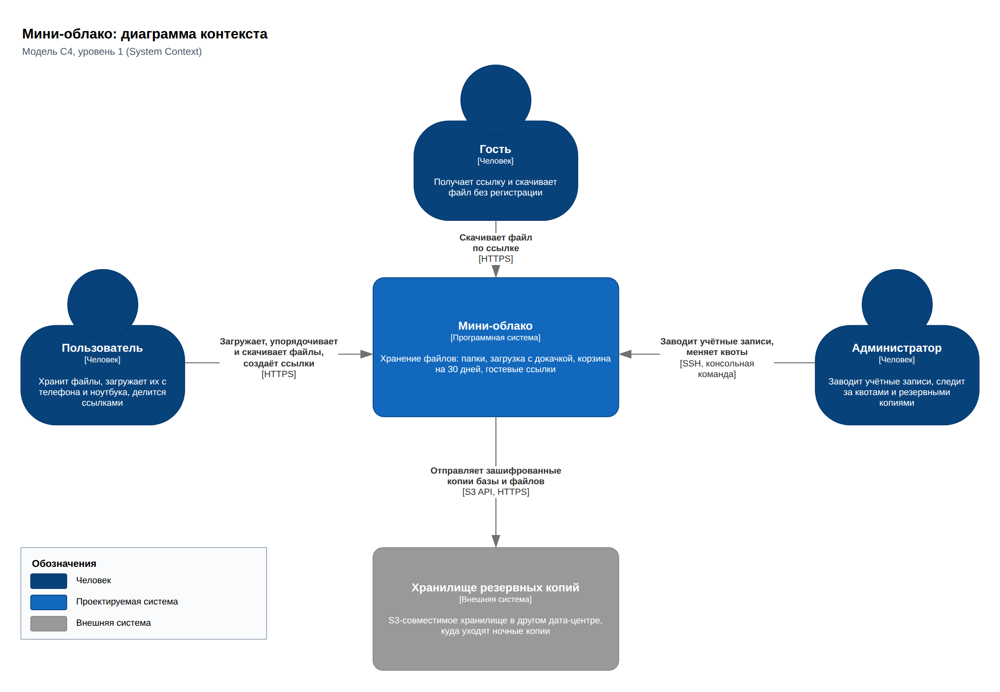
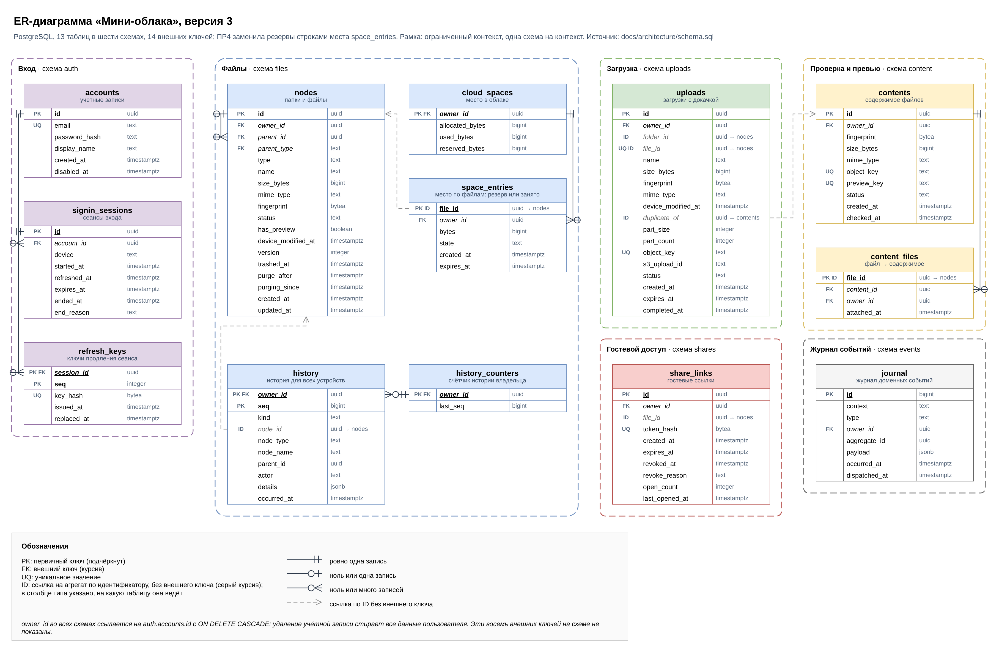
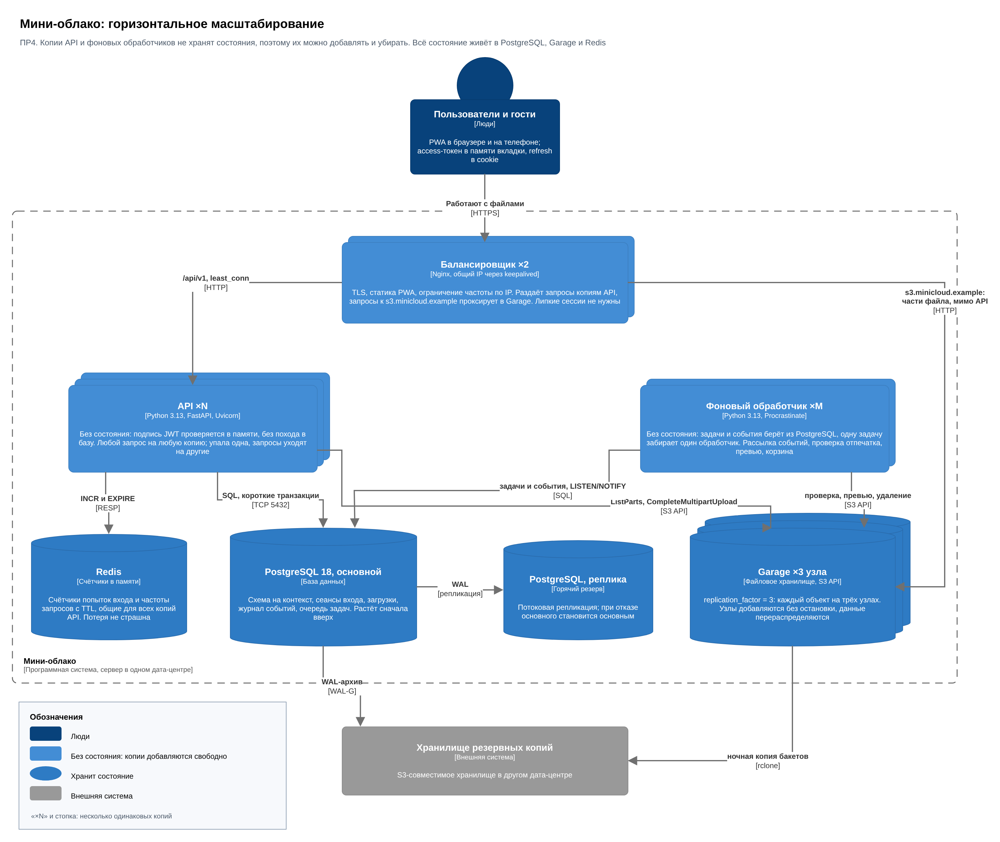

# Мини-облако: архитектура, модель предметной области и конкурентный доступ

Учебный проект по дисциплине «Создание клиент-серверных приложений» (Университет ИТМО, поток СКСП 1.2).
Авторы: Арройо Николас, Опалев Владимир.

«Мини-облако» задумано как небольшое файловое хранилище: папки, загрузка больших файлов с докачкой, корзина на 30 дней и гостевые ссылки. Проект продолжает практическую работу № 1, где мы разбирали архитектурные причины проблем СберДиска. В репозитории лежат архитектура (практическая работа № 2), модель предметной области, построенная методами DDD (практическая работа № 3), и решения о конкурентном доступе, токенах и масштабировании (практическая работа № 4). Код появится в следующем семестре.

## Коротко о решении

Модульный монолит на Python и FastAPI: один код, два типа процессов (API и фоновый обработчик), метаданные и очередь задач в PostgreSQL, файлы в S3-хранилище Garage. Браузер загружает части файла прямо в S3 по подписанным ссылкам, API работает только с метаданными. Почему так, а не иначе, записано в [ADR-001](docs/architecture/ADR-001.md).

Модули нарезаны по ограниченным контекстам модели: Вход, Файлы, Загрузка, Проверка и превью, Гостевой доступ. У каждого контекста своя схема в PostgreSQL, одна транзакция меняет один агрегат, а остальные узнают об изменении из журнала доменных событий. Как модель легла на базу и API, записано в [ADR-002](docs/architecture/ADR-002.md), сама модель (единый язык, агрегаты, инварианты, события) в [docs/domain/model.md](docs/domain/model.md).

Одновременные запросы разведены блокировками строк при уровне изоляции READ COMMITTED: место в облаке и содержимое блокируются пессимистично (`SELECT ... FOR UPDATE`), файлы и папки оптимистично (версия и `If-Match`). Копии API и фоновых обработчиков не хранят состояния и масштабируются горизонтально. Решения и их обоснование записаны в [ADR-003](docs/architecture/ADR-003.md), гонки можно воспроизвести скриптом [race-demo.py](docs/architecture/race-demo.py).


## Состав

```
.
├── README.md
├── .gitignore
└── docs/
    ├── architecture/
    │   ├── ADR-001.md              архитектура: критерии, варианты, риски
    │   ├── ADR-002.md              модель DDD в коде и данных: контексты, схемы, события
    │   ├── ADR-003.md              гонки и блокировки, токены, горизонтальное масштабирование
    │   ├── c4-diagram.drawio       C4: контекст, контейнеры, динамическая диаграмма загрузки
    │   ├── c4-context.png          экспорт страниц c4-diagram.drawio
    │   ├── c4-container.png
    │   ├── c4-dynamic-upload.png
    │   ├── openapi.yaml            контракт REST API, OpenAPI 3.0.3, версия 1.1.1
    │   ├── er-diagram.png          ER-диаграмма, версия 3
    │   ├── er-diagram.drawio       исходник ER-диаграммы
    │   ├── er-diagram.dbml         та же модель в DBML для dbdiagram.io
    │   ├── schema.sql              физическая схема PostgreSQL: схема на контекст, версия 3
    │   ├── schema-checks.sql       проверки ограничений схемы
    │   ├── race-demo.py            три гонки на живой базе: без блокировок и с ними
    │   ├── race-demo-output.txt    вывод race-demo.py на PostgreSQL 18.4
    │   ├── scaling.drawio          схема горизонтального масштабирования
    │   └── scaling.png             её экспорт
    └── domain/
        ├── model.md                единый язык, контексты, агрегаты, инварианты, события
        ├── ddd-model.drawio        карта контекстов, три агрегата, компоненты, поток событий
        ├── context-map.png         экспорт страниц ddd-model.drawio
        ├── aggregate-upload.png
        ├── aggregate-file.png
        ├── aggregate-session.png
        ├── components.png
        └── event-flow.png
```

Четыре обязательных артефакта ПР2: `ADR-001.md`, `c4-diagram.drawio`, `openapi.yaml`, `er-diagram.png`. Модель ПР3: `docs/domain/model.md` и `docs/domain/ddd-model.drawio`. ПР4: `ADR-003.md`, `race-demo.py`, `scaling.png`. Остальные файлы помогают их проверить.

## Как открыть и проверить

| Что | Как |
|---|---|
| C4, ER и модель DDD в draw.io | открыть `.drawio` на [app.diagrams.net](https://app.diagrams.net) (File → Open from → Device) |
| API | вставить `openapi.yaml` в [editor.swagger.io](https://editor.swagger.io) |
| Модель данных | вставить `er-diagram.dbml` в [dbdiagram.io](https://dbdiagram.io) |
| Линтер спецификации | `npx @redocly/cli lint docs/architecture/openapi.yaml` |
| Схема и её ограничения | на пустой базе PostgreSQL 16 или новее: `psql -v ON_ERROR_STOP=1 -f docs/architecture/schema.sql -f docs/architecture/schema-checks.sql` |
| Гонки и блокировки | на пустой базе после `schema.sql`: `pip install "psycopg[binary]"`, затем `python docs/architecture/race-demo.py "dbname=minicloud"`; нужен `max_connections` не меньше 110 |

Скрипт `schema-checks.sql` выполняет 84 проверки в одной транзакции и откатывает её, база остаётся пустой. Проверки сгруппированы по контекстам, в метках указаны инварианты модели («Файл И2», «Загрузка И5»). Мы прогоняли их на PostgreSQL 16.15 и 18.4. Базу нужно создавать в кодировке UTF8 и с локалью, в которой `lower()` понимает кириллицу, например `C.UTF-8`.

## Диаграммы

| Контекст системы | ER-диаграмма |
|---|---|
|  |  |

| Агрегат «Загрузка» | Поток событий при загрузке |
|---|---|
|  |  |



Загрузка файла с докачкой по шагам: [c4-dynamic-upload.png](docs/architecture/c4-dynamic-upload.png).
