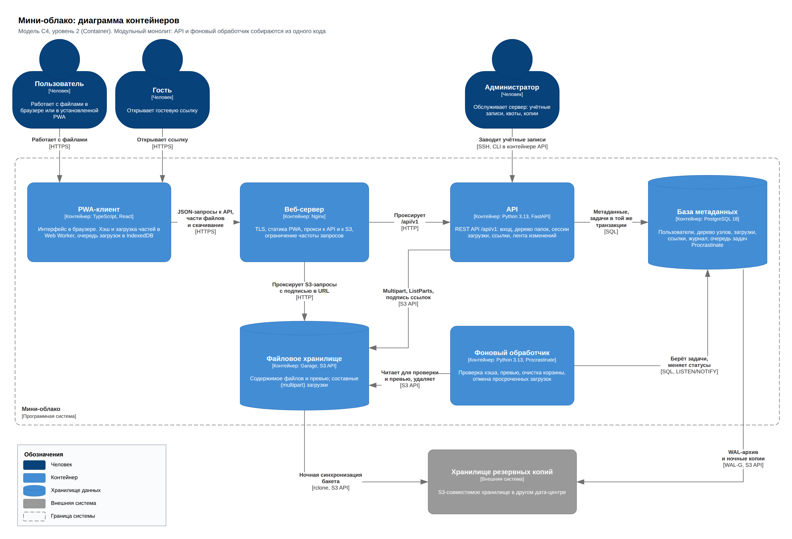

# Мини-облако: архитектурный паспорт

Учебный проект по дисциплине «Создание клиент-серверных приложений» (Университет ИТМО, поток СКСП 1.2).
Авторы: Арройо Николас, Опалев Владимир.

«Мини-облако» задумано как небольшое файловое хранилище: папки, загрузка больших файлов с докачкой, корзина на 30 дней и гостевые ссылки. Проект продолжает практическую работу № 1, где мы разбирали архитектурные причины проблем СберДиска. В этом репозитории лежит только архитектура: код появится в следующем семестре.

## Коротко о решении

Модульный монолит на Python и FastAPI: один код, два типа процессов (API и фоновый обработчик), метаданные и очередь задач в PostgreSQL, файлы в S3-хранилище Garage. Браузер загружает части файла прямо в S3 по подписанным ссылкам, API работает только с метаданными. Почему так, а не иначе, записано в [ADR-001](docs/architecture/ADR-001.md).



## Состав

```
.
├── README.md
├── .gitignore
└── docs/architecture/
    ├── ADR-001.md              решение об архитектуре: критерии, варианты, риски
    ├── c4-diagram.drawio       C4: контекст, контейнеры, динамическая диаграмма загрузки
    ├── c4-context.png          экспорт страниц c4-diagram.drawio
    ├── c4-container.png
    ├── c4-dynamic-upload.png
    ├── openapi.yaml            контракт REST API, OpenAPI 3.0.3
    ├── er-diagram.png          ER-диаграмма
    ├── er-diagram.drawio       исходник ER-диаграммы
    ├── er-diagram.dbml         та же модель в DBML для dbdiagram.io
    ├── schema.sql              физическая схема PostgreSQL
    └── schema-checks.sql       проверки ограничений схемы
```

Четыре обязательных артефакта: `ADR-001.md`, `c4-diagram.drawio`, `openapi.yaml`, `er-diagram.png`. Остальные файлы помогают их проверить.

## Как открыть и проверить

| Что | Как |
|---|---|
| C4 и ER в draw.io | открыть `.drawio` на [app.diagrams.net](https://app.diagrams.net) (File → Open from → Device) |
| API | вставить `openapi.yaml` в [editor.swagger.io](https://editor.swagger.io) |
| Модель данных | вставить `er-diagram.dbml` в [dbdiagram.io](https://dbdiagram.io) |
| Линтер спецификации | `npx @redocly/cli lint docs/architecture/openapi.yaml` |
| Схема и её ограничения | на пустой базе PostgreSQL 16 или новее: `psql -v ON_ERROR_STOP=1 -f docs/architecture/schema.sql -f docs/architecture/schema-checks.sql` |

Скрипт `schema-checks.sql` выполняет 42 проверки в одной транзакции и откатывает её, база остаётся пустой. Базу нужно создавать с локалью, в которой `lower()` понимает кириллицу, например `C.UTF-8`.

## Диаграммы

| Контекст | ER-диаграмма |
|---|---|
|  |  |

Загрузка файла с докачкой по шагам: [c4-dynamic-upload.png](docs/architecture/c4-dynamic-upload.png).
