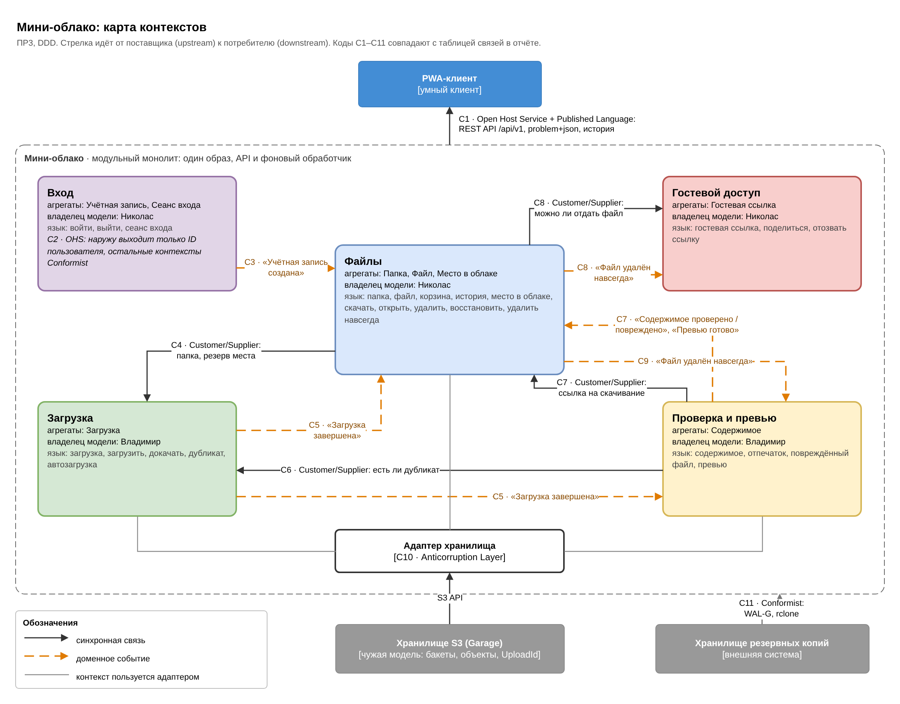
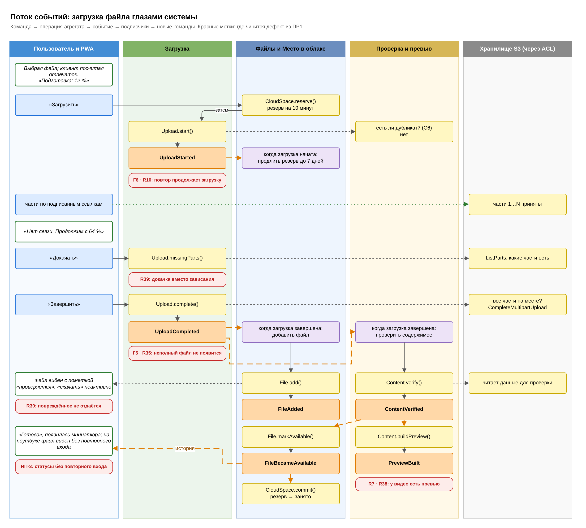
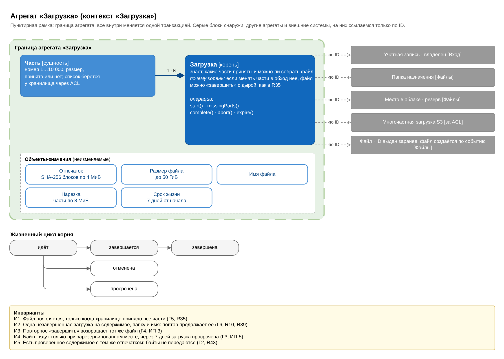
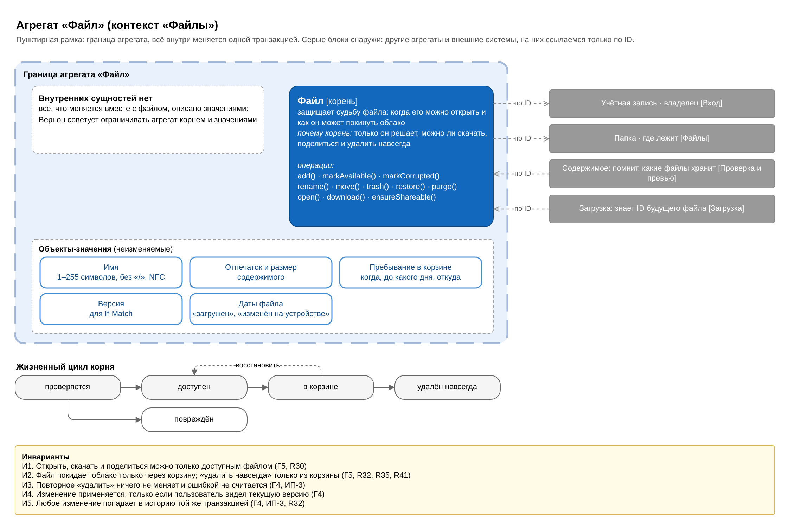
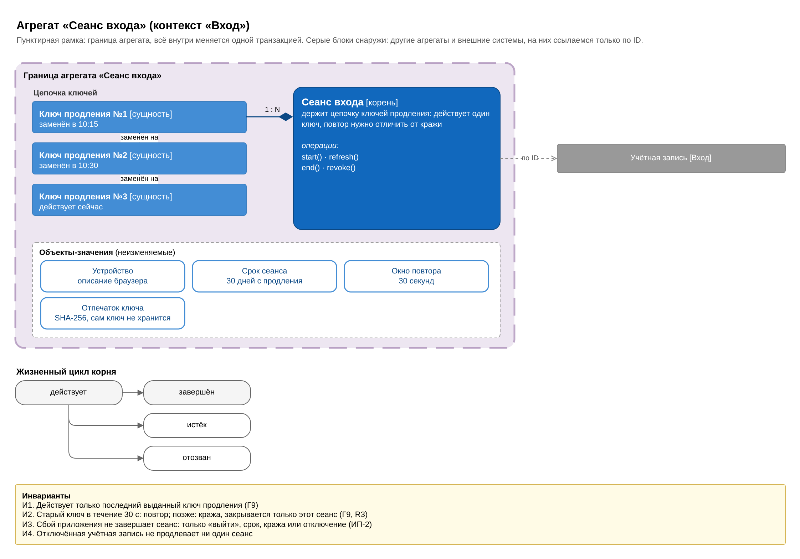
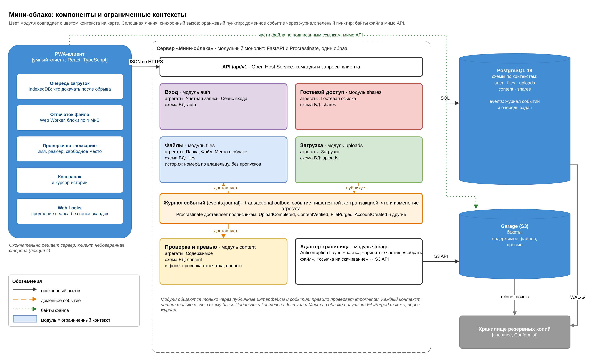

# Модель предметной области «Мини-облака»

Практическая работа № 3: модель, построенная методами DDD. Подробный разбор с отзывами, сценариями и исключениями лежит в отчёте; здесь короткая справка для разработки. Из этого файла берутся имена модулей, классов, методов и событий в коде, поэтому при расхождении с кодом прав этот файл, пока команда его не поменяет.

Как модель легла на базу и API, записано в [ADR-002](../architecture/ADR-002.md). Диаграммы: [ddd-model.drawio](ddd-model.drawio), шесть страниц, экспорт в PNG рядом.

## 1. Единый язык

| Термин | В коде | Что значит | Контекст |
|---|---|---|---|
| Место в облаке | `CloudSpace` | сколько выделил администратор и сколько занято файлами, включая корзину и дубликаты | Файлы |
| Папка | `Folder` | именованное место, где лежат файлы и другие папки | Файлы |
| Файл | `File` | документ, фото или видео под своим именем в какой-то папке | Файлы |
| Корзина | `Trash` | место, где удалённое ждёт 30 дней: можно восстановить, потом удаляется навсегда | Файлы |
| История | `History` | что происходило с файлами и папками; её видят все устройства владельца | Файлы |
| Загрузка | `Upload` | перенос одного файла с устройства в облако; можно прервать и продолжить | Загрузка |
| Автозагрузка | `AutoUpload` | загрузка по правилу «новые фото и видео сразу в облако»; в первой версии её нет | Загрузка |
| Дубликат | `duplicate_of` | файл, такое же содержимое которого уже есть у владельца; байты второй раз не передаются | Загрузка |
| Содержимое | `Content` | байты файла без имени и папки; одно содержимое хранит байты всех дубликатов владельца | Проверка и превью |
| Отпечаток | `Fingerprint` | цифровая подпись содержимого: SHA-256 от склейки SHA-256 блоков по 4 МиБ | Проверка и превью |
| Повреждённый файл | `File.markCorrupted()` | файл, содержимое которого не совпало с отпечатком; его можно только загрузить заново или удалить | Проверка и превью |
| Превью | `Preview` | уменьшенная картинка или кадр видео | Проверка и превью |
| Гостевая ссылка | `ShareLink` | ссылка, по которой человек без учётной записи скачивает один файл, пока не истёк срок | Гостевой доступ |
| Сеанс входа | `SignInSession` | время, пока устройство остаётся вошедшим: от «войти» до «выйти» | Вход |
| Загрузить | `Upload.start()` | отправить файл с устройства в облако | Загрузка |
| Докачать | `Upload.missingParts()` | продолжить прерванную загрузку с места обрыва | Загрузка |
| Скачать | `File.download()` | получить копию файла на устройство | Файлы |
| Открыть | `File.open()` | посмотреть файл в браузере, не скачивая целиком | Файлы |
| Удалить | `File.trash()` | переместить в корзину, это можно отменить 30 дней | Файлы |
| Восстановить | `File.restore()` | вернуть из корзины на прежнее место | Файлы |
| Удалить навсегда | `File.purge()` | стереть из корзины без возможности вернуть | Файлы |
| Поделиться | `ShareLink.create()` | создать гостевую ссылку на файл | Гостевой доступ |
| Отозвать ссылку | `ShareLink.revoke()` | сделать гостевую ссылку недействительной раньше срока | Гостевой доступ |
| Войти | `SignInSession.start()` | подтвердить email и паролем, кто ты, и начать сеанс входа | Вход |
| Выйти | `SignInSession.end()` | завершить сеанс входа на этом устройстве | Вход |

Слов «хэш», «квота», «сессия», «лента изменений», «blob» и «объект» в языке нет: их заменили «отпечаток», «место в облаке», «сеанс входа» или «загрузка», «история» и «содержимое». Слов «пропало» и «утеряно» тоже нет: у модели нет такого перехода, любое удаление идёт через корзину и записано в истории.

## 2. Контексты и модули

Каждый контекст стал модулем модульного монолита и схемой PostgreSQL. Модуль обращается к другому только через его публичный интерфейс или через события; правило проверяет import-linter.

| Контекст | Модуль и схема | Агрегаты | Владелец модели |
|---|---|---|---|
| Вход | `auth` | Учётная запись, Сеанс входа | Арройо Николас |
| Файлы | `files` | Место в облаке, Папка, Файл; история | Арройо Николас |
| Загрузка | `uploads` | Загрузка | Опалев Владимир |
| Проверка и превью | `content` | Содержимое | Опалев Владимир |
| Гостевой доступ | `shares` | Гостевая ссылка | Арройо Николас |

Модуль `storage` это Anticorruption Layer перед S3: слова «часть», «принятые части», «собрать файл», «ссылка на скачивание» он переводит в `CreateMultipartUpload`, `ListParts`, `CompleteMultipartUpload` и подписанные URL. Схема `events` не контекст, а транспорт: журнал доменных событий.

| № | Поставщик → потребитель | Паттерн | Что передаётся |
|---|---|---|---|
| С1 | Сервер → PWA | Open Host Service, Published Language | REST API `/api/v1`, ошибки `problem+json`, история с курсором |
| С2 | Вход → остальные | Open Host Service; остальные Conformist | только ID пользователя из access-токена |
| С3 | Вход → Файлы | события | AccountCreated: создать место в облаке и корневую папку |
| С4 | Файлы → Загрузка | Customer/Supplier | проверить папку назначения, зарезервировать место |
| С5 | Загрузка → Файлы, Проверка и превью | события | UploadCompleted, два подписчика |
| С6 | Проверка и превью → Загрузка | Customer/Supplier | есть ли проверенное содержимое с таким отпечатком |
| С7 | Проверка и превью → Файлы | события; Customer/Supplier | ContentVerified, ContentCorrupted, PreviewBuilt; ссылка на скачивание содержимого файла |
| С8 | Файлы → Гостевой доступ | Customer/Supplier; события | можно ли отдать файл гостю; FilePurged отзывает ссылки |
| С9 | Файлы → Проверка и превью | события | FilePurged: отвязать содержимое |
| С10 | S3 (Garage) → Загрузка, Проверка и превью, Файлы | Anticorruption Layer | модуль `storage` |
| С11 | Резервные копии → сервер | Conformist | WAL-G и rclone со своими форматами |

## 3. Агрегаты и инварианты

Правило «одна транзакция, один агрегат». Если операция затрагивает несколько агрегатов, первый меняется своей транзакцией и той же транзакцией пишет событие в `events.journal`, остальные реагируют на событие своими транзакциями. Подписчики идемпотентны.

Правила проверяет корень агрегата. Там, где это возможно, база держит второй рубеж; его проверки собраны в [schema-checks.sql](../architecture/schema-checks.sql).

| Агрегат | Инвариант | Второй рубеж в базе |
|---|---|---|
| Учётная запись | email уникален без учёта регистра | `accounts_email_uq` |
| | отключённая учётная запись не входит и не продлевает сеансы | только код |
| Сеанс входа | И1. Действует только последний выданный ключ продления | `refresh_keys_one_current_uq` |
| | И2. Старый ключ в течение 30 секунд: повтор, выдаётся следующий ключ; позже: кража, закрывается только этот сеанс | `end_reason = 'key_reused'` |
| | И3. Сбой приложения сеанс не завершает: только выход, срок, кража или отключение | список `end_reason` |
| | И4. Отключённая учётная запись не продлевает ни один сеанс | только код |
| Место в облаке | занятое и зарезервированное вместе не больше выделенного; выше выделенного можно оказаться только без резервов | `cloud_spaces_fits` |
| | дубликат и корзина занимают место как обычные файлы, повреждённый файл места не занимает | только код |
| Папка | имена соседей вне корзины уникальны без учёта регистра | `nodes_sibling_name_uq` |
| | родитель: папка того же владельца | составной ключ `nodes_parent_fk` |
| | папку нельзя вложить в неё саму или в её потомка; в папку из корзины ничего не положить | только код |
| | в корзину помечается только сама папка, её содержимое считается удалённым вместе с ней | `nodes_trash_pair` |
| Файл | И1. Открыть, скачать и поделиться можно только доступным файлом | только код |
| | И2. Файл покидает облако только через корзину | `nodes_purge_from_trash` |
| | И3. Повторное «удалить» ничего не меняет и ошибкой не считается | только код |
| | И4. Изменение применяется, только если пользователь видел текущую версию (`If-Match`) | `version > 0` |
| | И5. Любое изменение попадает в историю той же транзакцией, номера без пропусков | `files.history_counters` |
| Загрузка | И1. Файл появляется, только когда хранилище приняло все части | только код (ListParts) |
| | И2. Одна незавершённая загрузка на содержимое, папку и имя | `uploads_unfinished_uq` |
| | И3. Одна загрузка даёт один файл; повторное «завершить» возвращает тот же ответ | `file_id UNIQUE` |
| | И4. Байты идут только под зарезервированное место; через 7 дней загрузка просрочена | `uploads_s3_for_parts`, `space_reservations` |
| | И5. Дубликат не передаётся: загрузка сразу завершена | `uploads_parts`, `uploads_nothing_to_send` |
| Содержимое | у владельца одно проверенное содержимое на один отпечаток; копия, проверенная позже, сливается с ним | `contents_owner_fingerprint_uq` |
| | файл хранит байты только в содержимом своего владельца | составной ключ `content_files_same_owner` |
| | содержимое удаляется, когда на него не ссылается ни один файл | внешний ключ из `content_files` |
| Гостевая ссылка | открывается, только пока не истекла, не отозвана, а файл доступен и не в корзине | только код (спрашивает Файлы) |
| | живёт не больше 30 дней; в базе только отпечаток токена | `share_links_term`, `token_hash` |

Блокировки выбраны по правилу из лекции 5: по частоте конфликтов и цене ошибки.

| Что | Блокировка | Почему |
|---|---|---|
| Место в облаке | короткая пессимистичная: строка `cloud_spaces` владельца | загрузки из одной папки идут десятками, ошибка дорогая: переполнение |
| История | короткая пессимистичная: строка `history_counters` владельца | без неё номера идут не по порядку фиксации, и устройство пропускает изменение |
| Файл, Папка | оптимистичная: версия, `If-Match`, ответ 412 | две вкладки правят один файл редко |
| Загрузка | уникальность незавершённой загрузки | второй запрос становится продолжением, а не ошибкой |
| Сеанс входа | Web Locks в браузере и окно 30 секунд на сервере | гонку вкладок нужно отличить от кражи |
| Гостевая ссылка | атомарное `open_count = open_count + 1` | сама ссылка не меняется |

## 4. Доменные события

Имена в прошедшем времени: это факты, а не команды. Список совпадает с ограничением `journal_known_event` в схеме.

| Событие | Контекст | Подписчики |
|---|---|---|
| AccountCreated | Вход | Файлы: создать место в облаке и корневую папку |
| SignedIn, SessionRefreshed, SessionEnded, SessionRevoked | Вход | журнал безопасности |
| SpaceReserved | Файлы | нет; резерв без начатой загрузки снимает фоновая задача через 10 минут |
| FolderCreated, FileAdded | Файлы | нет; запись в истории пишется той же транзакцией |
| FileBecameAvailable | Файлы | Место в облаке: резерв становится занятым местом |
| FileCorrupted | Файлы | Место в облаке: снять резерв |
| FileRenamed, FileMoved, FolderRenamed, FolderMoved | Файлы | нет |
| FileTrashed, FolderTrashed, FileRestored, FolderRestored | Файлы | нет; гостевая ссылка спрашивает Файлы при каждом открытии |
| FilePurged | Файлы | Место в облаке: освободить; Проверка и превью: отвязать содержимое; Гостевой доступ: отозвать ссылки |
| FolderPurged | Файлы | нет; файлы внутри дают свои FilePurged |
| UploadStarted | Загрузка | Место в облаке: продлить резерв до срока загрузки |
| UploadCompleted | Загрузка | Файлы: `File.add()`; Проверка и превью: `Content.register()` |
| UploadAbandoned | Загрузка | Место в облаке: снять резерв |
| ContentVerified | Проверка и превью | Файлы: `File.markAvailable()`; Проверка и превью: построить превью |
| ContentCorrupted | Проверка и превью | Файлы: `File.markCorrupted()` |
| PreviewBuilt | Проверка и превью | Файлы: показать превью |
| ContentDeleted | Проверка и превью | задача модуля `content` удаляет объект и превью через адаптер хранилища |
| ShareLinkCreated, ShareLinkOpened, ShareLinkRevoked | Гостевой доступ | нет |

## 5. Что база не проверяет

Эти правила живут только в корнях агрегатов, поэтому на них нужны модульные тесты:

- перенос папки в собственное поддерево и любой новый узел в папке из корзины;
- что папка назначения загрузки и файл гостевой ссылки принадлежат тому же владельцу: это ссылки между контекстами по ID, внешних ключей между ними нет;
- что повтор старого ключа продления пришёл в течение 30 секунд;
- что `reserved_bytes` в `cloud_spaces` равен сумме резервов, а `used_bytes` сумме размеров доступных файлов; расхождение ищет ночная сверка.

## Диаграммы

| Агрегат «Загрузка» | Агрегат «Файл» | Агрегат «Сеанс входа» |
|---|---|---|
|  |  |  |

